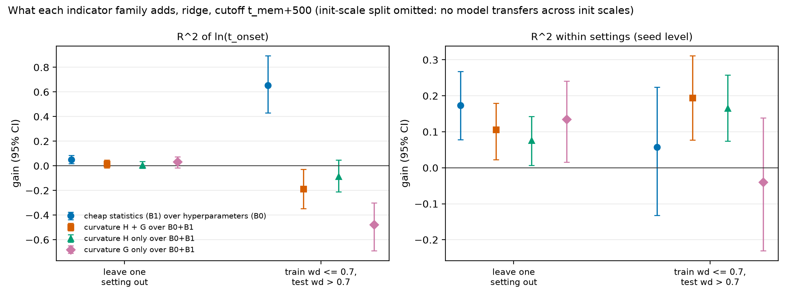

# eigengrok: does loss curvature forecast grokking?

**Finding.** Across 240 training runs of a small transformer that groks modular addition, Hessian and Gauss-Newton
curvature measured shortly after memorization adds only a small amount to predicting *when* a run will generalize
(+0.11 [0.02, 0.18] seed-level R², on top of 0.17 from hyperparameters and cheap training statistics). The clearest
curvature signal, a sharp collapse in effective rank, happens *at* the grokking transition, not before it.

- **Setup.** 1-layer transformer (221,824 parameters) on a + b mod 91, 30% of pairs for training, full-batch AdamW.
  240 runs: 12 weight decays (0.45 to 1.0) x 2 initialization scales (1, 8) x 10 seeds, 150k steps each. The Hessian
  H and its Gauss-Newton part G are estimated by stochastic Lanczos quadrature on the full training set, at every
  checkpoint a run keeps (a log-spaced grid shared by all runs, plus every 100 steps around the run's onset).
- **Finding.** Curvature features improve the out-of-sample forecast of the onset step a little, under the
  leave-one-hyperparameter-setting-out test fixed in advance. The gain is small, depends on modelling choices, and
  is not consistent across every robustness check (details below). Along the way: the original sweep's repeated
  post-grokking collapses were caused by Adam's beta2, not floating-point precision; beta2 = 0.98 cuts them to
  0.085x.
- **Validation.** The estimator is tested against exact Hessians (H, G and H = G + H_f to 1e-10), checked on the
  real network, and shown to measure *changes* between checkpoints 2.6-8.7x more precisely than absolute values, because
  each run reuses the same random probes at every checkpoint. Every number in this README is computed by a script
  from data in the repo: [`RESULTS.md`](RESULTS.md) maps each claim to its script, data file and exact values.

## Headline figures

**Curvature around the transition** (one run, with the median and interquartile band of its 10 seeds, aligned on
each run's own onset): effective rank of both H and G drops sharply at onset.


**What curvature adds to the forecast.** Gain in R² of ln(onset step) from each indicator family, out of sample,
with 95% bootstrap intervals. Right panel: seed-level prediction (deviations from each setting's mean), where the
hyperparameters alone score zero by construction.



**The training instability that had to be fixed first.** Test accuracy per seed at weight decay 1.0. With PyTorch's
default AdamW (beta2 = 0.999) every run repeatedly loses its solution after grokking; beta2 = 0.98 removes most
collapses; float64 does not.


## Results

95% bootstrap intervals over seeds, resampled within hyperparameter settings. Full tables:
[`reports/forecast_summary.md`](reports/forecast_summary.md), [`reports/sweep_comparison.md`](reports/sweep_comparison.md),
[`reports/collapse_pilot_summary.md`](reports/collapse_pilot_summary.md), [`reports/spectral_validation.md`](reports/spectral_validation.md).

**Forecasting the onset step** (target ln(first step with test accuracy >= 0.5); features use only training up to
500 steps after memorization; every run is predicted by a model that never saw its hyperparameter setting):

| model | R² within settings, hyperparameters + cheap statistics | gain from adding curvature (H and G) |
|---|---|---|
| ridge (headline, fixed in advance) | 0.17 [0.08, 0.27] | **+0.106 [+0.022, +0.180]** |
| gradient-boosted trees | 0.48 [0.38, 0.58] | +0.120 [+0.021, +0.216] |
| ridge, without clipping held-out features to the training range | 0.17 | +0.034 [-0.132, +0.163] |

30% of the variance in ln(onset) is between seeds of the same setting; that is the part curvature would have to
explain. Across the other 59 curvature-vs-baseline comparisons (four cutoffs, two models, H and G separately, a
weight-decay extrapolation split, two alternative onset definitions), 22 intervals lie above zero, 7 below, and the
rest include zero.

**Training stability** (sweep rerun with AdamW beta2 = 0.98 against the original beta2 = 0.999, same seeds):

| | init 1 | init 8 |
|---|---|---|
| post-grokking collapses per run, rerun / original | 0.085x [0.075, 0.096] | 0.087x [0.078, 0.097] |
| onset step, rerun / original (geometric mean) | 1.11x [1.05, 1.17] | 1.03x [0.98, 1.07] |

In a 10-seed pilot, float64 left collapses at 0.86x [0.66, 1.10] of the default, and gradient clipping removed them
but delayed onset 1.82x [1.45, 2.89].

**Estimator** (stochastic Lanczos quadrature, m=20 Lanczos steps, k=20 probes): over one checkpoint gap, the change
in the Hessian trace is measured with 2.9% median error when the run's probes are reused, against 15% with fresh
probes. H and G together cost 2.3 s per checkpoint on one A100, 24x less than the previous setting.

## Compute

From SLURM accounting ([`reports/compute_budget.md`](reports/compute_budget.md), `python scripts/compute_budget.py`):

| job | A100-hours |
|---|---|
| collapse pilot, 40 runs of 30k steps | 3.7 |
| sweep rerun, 240 runs of 150k steps | 113.4 |
| curvature spectra at every kept checkpoint of the 240 runs | 13.8 |
| estimator cost benchmark | 0.1 |
| **total** | **131.1** |

The original beta2 = 0.999 sweep is not included: its job IDs were not recorded.

## Limitations

- **One task, one small model.** Modular addition at p = 91 with a 1-layer transformer. Nothing here says how
  curvature behaves on larger models or natural data.
- **The effect is small and sensitive to analysis choices.** The ridge headline is +0.11 with held-out features
  clipped to the training range, and +0.03 [-0.13, +0.16] without. Clipping was added after the first full run to
  stop one split extrapolating, and it moved the headline. Boosted trees, which cannot extrapolate, give +0.12
  either way.
- **Many comparisons.** 59 robustness comparisons were run besides the headline. Most positive intervals are modest, and some
  settings (absolute-step cutoffs, boosted trees at later cutoffs) show no gain or a loss.
- **No transfer across initialization scale.** Trained on one init scale and tested on the other, every model fails
  (R² far below zero): memorization time barely varies within an init scale, so nothing carries over.
- **Results describe beta2 = 0.98 training.** That fix delays onset 1.11x at init 1. The estimator's change precision
  was validated on a 2.6k-parameter fixture, not the production network.
- **Data provenance.** Most checkpoints of the original sweep were deleted from scratch storage before this
  analysis. Its accuracy curves survive in the repo, but its curvature could not be recomputed, which is one reason
  the sweep was rerun.

## Reproduce

Python 3.11+.

```bash
python -m venv .venv && source .venv/bin/activate
pip install -e ".[dev]"     # exact versions pinned in requirements.txt
make test                   # unit and end-to-end tests, about a minute on one CPU core
```

Every table and figure above, from the committed data, on a CPU:

```bash
python scripts/sweep_summary.py --accuracy-csv reports/sweep_beta2_0.98_accuracy_curves.csv.gz --out-dir reports/sweep_beta2_0.98
python scripts/compare_sweeps.py                         # reports/sweep_comparison.{md,csv}
python scripts/collapse_report.py --from-csv             # reports/collapse_pilot_*, reports/figures/collapse_pilot_test_acc.*
python scripts/validate_spectral_changes.py --from-csv   # generated section of reports/spectral_validation.md
python scripts/forecast_benchmark.py                     # reports/forecast_{results,predictions}.csv, forecast_summary.md (~30 min)
python scripts/figures/forecast_figures.py               # reports/figures/forecast_*.{png,pdf}
python scripts/make_numbers.py                           # RESULTS.md
python scripts/sweep_summary.py                          # the original beta2 = 0.999 sweep: reports/sweep_summary.{md,csv}
```

Regenerating the data itself needs GPUs (SLURM scripts in `scripts/`):

```bash
sbatch scripts/run_collapse_pilot_array.sh               # collapse pilot (configs/collapse_pilot.yaml)
sbatch scripts/run_wd_sweep_rerun_array.sh               # 240-run sweep (configs/mod91_wd_sweep_beta2_0.98.yaml)
sbatch --dependency=aftercorr:<sweep job> scripts/run_spectral_sweep_array.sh   # curvature at kept checkpoints
sbatch --dependency=afterany:<spectra job> --export="ALL,EIGENGROK_REPO=$PWD" scripts/run_audit_pipeline.sh  # everything above
```

`scripts/build_wd_sweep_accuracy_csv.py` extracts the curves from the run directories and never overwrites a data
file with fewer runs than it already holds. A single run: `python -m eigengrok.train --config <config.yaml> --set
key=value ...`; the resolved config is saved as `config_full.json` in the run directory.

## Layout

```
eigengrok/
  config.py      ExperimentConfig (YAML in, config_full.json out)
  data/          modular arithmetic and torchvision datasets
  models/        transformer, MLP
  tasks/         task = data + model + loss
  train/         training loop (Adam betas, gradient clipping, instability diagnostics), CLI
  hessian/       Hessian / Gauss-Newton / functional operators, Lanczos, SLQ statistics
  analysis/      grokking milestones, bootstrap intervals, checkpoint grid, forecasting features and evaluation
configs/         YAML experiment configs
scripts/         SLURM launchers, post-hoc analysis, report and figure generators
tests/           pytest suite
reports/         data (curves, spectra), generated summaries and figures
RESULTS.md       every reported number, with the script and data behind it
```
