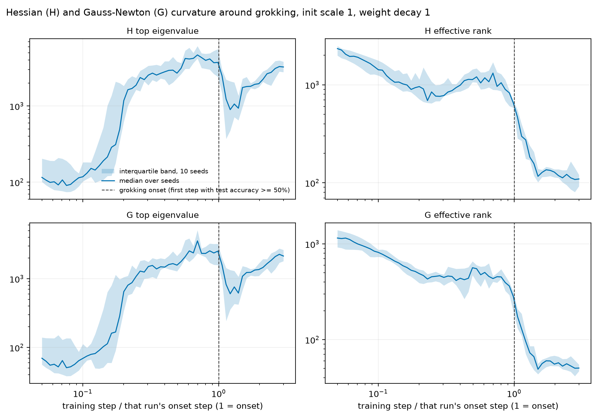
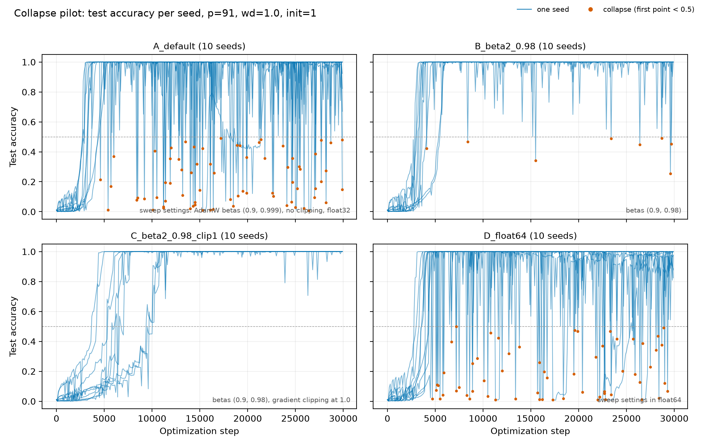

# eigengrok

Grokking is a form of delayed generalization in neural networks, first reported by
[Power et al. (2022)](https://arxiv.org/abs/2201.02177). The network quickly memorizes its training data (training
accuracy reaches ~100%), but only starts to generalize (test accuracy rises) thousands of steps later.

This project asks whether there are early warning signs before grokking happens, focusing on the curvature of the loss
landscape.

We train 240 small transformers on modular addition (a + b mod 91), varying the weight decay, the initialization scale
(a constant that multiplies the initial weights) and the random seed (which sets both the initial weights and which 30%
of the (a, b) pairs are used for training). We track the Hessian of the loss with respect to the network parameters
throughout training, and try to predict when each run groks using only the first 500 steps after it has memorized the
training set.

We find that curvature-based indicators improve the prediction only slightly over a baseline that uses the
hyperparameters and a few cheap training statistics (training loss, weight norms, gradient norm). The clearest
curvature signal, a sharp drop in effective rank, starts at the same checkpoint as the transition (when test loss
starts to fall off its plateau), not before it, so it is not an early warning sign.

We track two curvature matrices: the full Hessian H, and its Gauss-Newton part G, which keeps only the curvature of
the loss with respect to the network's outputs (treating the network as locally linear). The remainder H - G comes from
the network's own second derivatives. Both matrices behave alike around the transition, and neither is clearly better
for prediction.



*Median (line) and interquartile range (band) over the 10 seeds of one setting. Each run's steps are divided by its
own grokking step, so the dashed line marks the moment each run groks.*

## Results

To check that the predictions generalize, we hold out one hyperparameter setting at a time (one weight decay and
initialization scale, i.e. 10 runs), fit the predictor on the other 23 settings, and predict the held-out runs. A
predictor therefore cannot succeed just by recognizing which setting a run came from.

Most of the variation in grokking time comes from the hyperparameters; 30% of the variance of log(grokking step) is
between seeds of the same setting. The hyperparameters cannot explain that part, so it is what we score: R² computed
after subtracting each setting's average from both the true and the predicted values. A score of 0 is no better than
knowing the setting. Brackets are 95% bootstrap intervals.

| Model | Baseline (hyperparameters + training stats) | Curvature gain |
|---|---|---|
| Ridge regression | 0.17 [0.08, 0.27] | +0.106 [+0.022, +0.180] |
| Gradient-boosted trees | 0.48 [0.38, 0.58] | +0.120 [+0.021, +0.216] |

Curvature helps, but not much: the seed-level R² goes from 0.17 to 0.28 with ridge, and from 0.48 to 0.60 with
trees. Notably, the cheap statistics alone already explain about half of the seed-to-seed variation once they are
combined non-linearly (0.48 with trees).

## When does each indicator change?

To check the timing, we date, in every run, where each indicator's steepest change begins, and compare it with the
start of the transition: the step where test loss starts to fall off the plateau it sits on after memorization. In
the median run that is 6% of the grokking step before test accuracy reaches 50%. The lead time is the difference in
units of the run's grokking step; positive means the indicator changes first. Each series is split into straight
pieces by least squares, and the change is the start of its steepest piece, read every 100 steps between 0.5 and 1.5
times the grokking step ([details](reports/transition_leadtimes.md)).

| Indicator | Median lead [95% CI] | Runs where it changes first |
|---|---|---|
| Effective rank, H | +0.00 [+0.00, +0.04] | 49% |
| Effective rank, G | +0.00 [-0.03, +0.03] | 47% |
| Outlier count, H | +0.17 [+0.12, +0.20] | 73% |
| Outlier count, G | +0.19 [+0.16, +0.24] | 76% |
| Top eigenvalue, H | -0.13 [-0.18, -0.06] | 35% |
| Trace, H | -0.14 [-0.21, -0.07] | 36% |
| Training loss | -0.10 [-0.13, -0.05] | 36% |
| Gradient norm | -0.08 [-0.13, -0.04] | 33% |

The effective-rank collapse starts at the same checkpoint as the test loss drop in the median run, and first in about
half the runs. Individual runs scatter widely (for H, the middle half of lead times runs from -0.11 to +0.19), partly because
a single changepoint is imprecise: H and G effective rank move together, yet their changepoints in the same run differ
by a median 0.06. The number of outlier eigenvalues (those separated from the bulk of the spectrum) is the one
curvature statistic that consistently changes earlier, but this analysis looks back from each run's known grokking
step, so it describes the transition and does not forecast it. The top eigenvalue, the trace and the cheap statistics
change after the transition has started; the weight norm (not shown) falls steadily throughout and has no change tied
to the transition.


## Fixing a training instability

In the first version of the sweep, every run repeatedly lost its solution after grokking: test accuracy crashed from
above 95% to below 50%, a median of 39 times in 150k steps. We traced this to AdamW's default beta2 = 0.999. Setting
beta2 = 0.98 cut the number of collapses to about a tenth and delayed grokking by 10% or less.

All results above come from runs with beta2 = 0.98.



*Test accuracy of 10 seeds under four optimizer settings (weight decay 1, 30k steps); dots mark collapses. Running in
float64 does not help, so it is not a numerical precision problem.*

## Estimating the Hessian spectrum

The Hessian of a 220k-parameter network is too large to form, so we estimate its spectrum with stochastic Lanczos
quadrature ([Ghorbani et al., 2019](https://arxiv.org/abs/1901.10159); [Yao et al., 2020](https://arxiv.org/abs/1912.07145)),
which only needs Hessian-vector products. We compute it on the full training set. The method averages over random probe
vectors, so every estimate carries some random error. Because all checkpoints of a run use the same probes, most of
that error is shared between checkpoints and cancels out in how curvature changes over training, which is what the
predictors use. We tested the estimator against exact Hessians on small models where the full Hessian can be computed.

Each checkpoint takes about 2.3 s on an A100.

## Limitations

- We have only studied one task and one small model, so these conclusions may not hold for larger models or other
  datasets.
- The gain is small and sensitive to analysis choices. When a held-out setting has feature values outside the range
  seen in training, we cap them at that range so the linear model does not extrapolate. We added this step after the
  first full run, and without it the ridge gain shrinks to +0.03, indistinguishable from zero. We also repeated the
  analysis with different cutoffs, models, curvature subsets and definitions of grokking time: some of these variants
  show a gain and some do not.
- A predictor fit only on one initialization scale fails on the other. The two scales behave very differently early in
  training (scale 8 memorizes at a median of step 1,700, scale 1 at step 200), so nothing learned on one carries over.

## Reproduce

```bash
pip install -e ".[dev]"     # Python 3.11+, versions pinned in requirements.txt
make test
EIGENGROK_REPO=$PWD bash scripts/run_audit_pipeline.sh   # every table and figure from the data in reports/ (~30 min on CPU)
```

Training and curvature need GPUs; the SLURM scripts are in `scripts/`. [`RESULTS.md`](RESULTS.md) lists every
number with the script and data behind it, and `reports/` has the full tables, including all the robustness checks.
