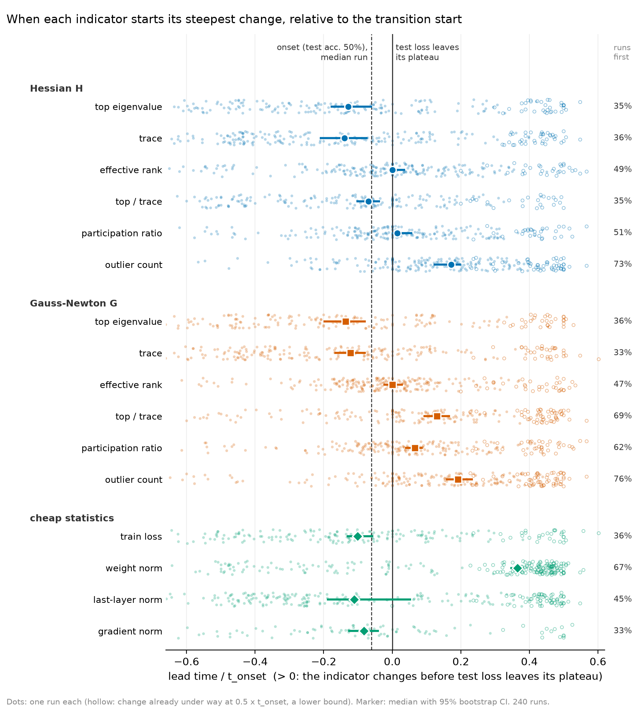

# When does each indicator change, relative to the grokking transition?

Generated by `python scripts/transition_leadtimes.py`. Method: `eigengrok/analysis/changepoints.py`. Intervals: 95% bootstrap over runs, resampled within (init, wd) settings.

## Method

For each of the 240 runs, each indicator is read at the run's checkpoints in the window [0.5, 1.5] x t_onset (every 100 steps; every series of a run at the same steps, so the cheap statistics get no finer time resolution than the curvature). After the forecast features' transform (log, log1p or asinh) and removing spikes (a Hampel filter: points more than 3 robust SDs from their 5-point running median), the series is split into at most 5 linear pieces by exact least squares, with the number of pieces chosen by BIC; a change is called if that beats a single line by >= 20 in BIC (calibrated by simulation: a straight line plus white or heavy-tailed noise clears it in about 5% of draws). The **changepoint** is where the series' steepest episode starts: the piece with the steepest net slope, extended backwards over adjacent pieces moving the same way at >= 0.33 of that slope.

The **transition start** is the changepoint of test loss, i.e. where it leaves its post-memorization plateau. **Lead time** = transition start - indicator changepoint, in units of the run's t_onset; positive means the indicator changes first.

## The transition start

Test loss leaves its plateau a median 6% of t_onset (400 steps) before onset (interquartile 2% to 11%); 240/240 runs have a detected change, 1 of them already falling at 0.5 x t_onset, and in 12 the steepest drop starts after onset (test loss comes down a staircase there, mostly at init 1 and low weight decay, and a later step is the steepest).

## Headline: the effective-rank collapse

- H effective rank: median lead +0.00 x t_onset [+0.00, +0.04] (+0 steps), interquartile -0.11 to +0.19; it changes first in 49% [43%, 55%] of runs, and is already falling at 0.5 x t_onset in 29.
- G effective rank: median lead +0.00 x t_onset [-0.03, +0.03] (+0 steps), interquartile -0.11 to +0.12; first in 47% [41%, 53%] of runs, already falling in 33.
- How precise is one changepoint? H and G effective rank move together, yet their changepoints in the same run differ by a median 6% of t_onset (interquartile -0.06 to +0.07); they fall within 200 steps of each other in 38% of runs.
- For scale: a changepoint placed uniformly at random in the window would sit a median 0.25 x t_onset from the transition start; H and G effective rank sit 0.14 and 0.11.

## Every indicator, side by side

Lead in units of t_onset. *Already falling/rising* counts runs whose steepest episode is under way when the window opens (0.5 x t_onset): their lead is a lower bound, and a median marked >= is one where those runs are half or more; *in window* is the median over the other runs. *Falls* is the share of detected changes that are decreases. *vs onset* measures the lead from t_onset (test accuracy 50%) instead.

| family | indicator | changes detected | already under way | falls | median lead [CI] | interquartile | in window | runs first [CI] | same checkpoint | runs after | vs onset |
|---|---|---|---|---|---|---|---|---|---|---|---|
| Hessian H | top eigenvalue | 190/240 | 33 | 62% | -0.13 [-0.18, -0.06] | -0.36 to +0.17 | -0.20 | 35% [28%, 41%] | 1% | 65% | -0.05 |
| Hessian H | trace | 217/240 | 38 | 65% | -0.14 [-0.21, -0.07] | -0.41 to +0.12 | -0.25 | 36% [30%, 41%] | 1% | 63% | -0.05 |
| Hessian H | effective rank | 223/240 | 29 | 86% | +0.00 [+0.00, +0.04] | -0.11 to +0.19 | -0.01 | 49% [43%, 55%] | 8% | 43% | +0.08 |
| Hessian H | top / trace | 192/240 | 23 | 21% | -0.07 [-0.10, -0.04] | -0.31 to +0.10 | -0.10 | 35% [29%, 42%] | 7% | 58% | -0.00 |
| Hessian H | participation ratio | 212/240 | 30 | 87% | +0.02 [+0.00, +0.06] | -0.09 to +0.22 | -0.01 | 51% [46%, 57%] | 6% | 43% | +0.08 |
| Hessian H | outlier count | 229/240 | 52 | 79% | +0.17 [+0.12, +0.20] | +0.00 to +0.33 | +0.09 | 73% [68%, 79%] | 7% | 20% | +0.25 |
| Gauss-Newton G | top eigenvalue | 183/240 | 30 | 61% | -0.14 [-0.20, -0.08] | -0.37 to +0.12 | -0.21 | 36% [30%, 42%] | 2% | 63% | -0.06 |
| Gauss-Newton G | trace | 216/240 | 33 | 71% | -0.12 [-0.17, -0.08] | -0.37 to +0.09 | -0.19 | 33% [27%, 38%] | 1% | 66% | -0.05 |
| Gauss-Newton G | effective rank | 233/240 | 33 | 94% | +0.00 [-0.03, +0.03] | -0.11 to +0.12 | -0.03 | 47% [41%, 53%] | 5% | 48% | +0.07 |
| Gauss-Newton G | top / trace | 194/240 | 51 | 22% | +0.13 [+0.09, +0.17] | -0.04 to +0.38 | +0.03 | 69% [62%, 75%] | 5% | 27% | +0.22 |
| Gauss-Newton G | participation ratio | 215/240 | 37 | 87% | +0.07 [+0.04, +0.09] | -0.06 to +0.25 | +0.02 | 62% [56%, 68%] | 3% | 34% | +0.12 |
| Gauss-Newton G | outlier count | 226/240 | 63 | 83% | +0.19 [+0.16, +0.24] | +0.01 to +0.38 | +0.09 | 76% [70%, 81%] | 5% | 19% | +0.27 |
| cheap statistics | train loss | 192/240 | 30 | 69% | -0.10 [-0.13, -0.05] | -0.31 to +0.12 | -0.15 | 36% [30%, 43%] | 2% | 61% | -0.03 |
| cheap statistics | weight norm | 218/240 | 132 | 94% | >= +0.36 [+0.34, +0.38] | -0.16 to +0.45 | -0.26 | 67% [63%, 70%] | 0% | 33% | +0.49 |
| cheap statistics | last-layer norm | 230/240 | 60 | 18% | -0.11 [-0.19, +0.05] | -0.33 to +0.36 | -0.25 | 45% [39%, 51%] | 0% | 54% | -0.02 |
| cheap statistics | gradient norm | 88/240 | 13 | 70% | -0.08 [-0.13, -0.04] | -0.25 to +0.08 | -0.13 | 33% [25%, 41%] | 1% | 66% | -0.03 |

## Sensitivity

Median lead (units of t_onset) under each variant of the detector, one setting changed at a time; the transition start is re-detected under the same variant.

| indicator | primary | spike filter 3 wide | no spike filter | episode fraction 1/2 | BIC margin 40 | up to 7 pieces | steepest fall only |
|---|---|---|---|---|---|---|---|
| Hessian H: top eigenvalue | -0.13 | -0.13 | -0.13 | -0.08 | -0.13 | -0.15 | -0.08 |
| Hessian H: trace | -0.14 | -0.14 | -0.13 | -0.08 | -0.13 | -0.16 | -0.07 |
| Hessian H: effective rank | +0.00 | +0.05 | +0.12 | +0.01 | +0.00 | +0.00 | +0.01 |
| Hessian H: top / trace | -0.07 | -0.01 | +0.04 | -0.04 | -0.08 | -0.03 | -0.04 |
| Hessian H: participation ratio | +0.02 | +0.06 | +0.15 | +0.05 | +0.01 | +0.02 | +0.02 |
| Hessian H: outlier count | +0.17 | +0.19 | +0.22 | +0.21 | +0.17 | +0.17 | +0.18 |
| Gauss-Newton G: top eigenvalue | -0.14 | -0.12 | -0.11 | -0.08 | -0.11 | -0.16 | -0.07 |
| Gauss-Newton G: trace | -0.12 | -0.15 | -0.13 | -0.07 | -0.13 | -0.16 | -0.08 |
| Gauss-Newton G: effective rank | +0.00 | +0.02 | +0.06 | +0.00 | +0.00 | +0.00 | +0.00 |
| Gauss-Newton G: top / trace | +0.13 | +0.19 | +0.31 | +0.14 | +0.10 | +0.11 | +0.11 |
| Gauss-Newton G: participation ratio | +0.07 | +0.14 | +0.14 | +0.07 | +0.05 | +0.05 | +0.06 |
| Gauss-Newton G: outlier count | +0.19 | +0.19 | +0.25 | +0.22 | +0.19 | +0.18 | +0.19 |
| cheap statistics: train loss | -0.10 | -0.08 | +0.00 | -0.06 | -0.13 | -0.07 | -0.07 |
| cheap statistics: weight norm | +0.36 | +0.36 | +0.37 | +0.42 | +0.38 | +0.38 | +0.38 |
| cheap statistics: last-layer norm | -0.11 | -0.14 | -0.17 | -0.13 | -0.13 | -0.16 | -0.34 |
| cheap statistics: gradient norm | -0.08 | -0.06 | +0.02 | -0.06 | -0.08 | +0.00 | -0.06 |

## Caveats

- The window is placed using each run's own onset, so this describes the transition after the fact; it is not a forecast. Any change more than about 0.45 x t_onset before the transition start is outside the window and shows up only as *already under way*.
- One changepoint per series. A series with several separate changes in the window is dated by the steepest. Where test loss comes down a staircase, the transition start is its steepest step, and an indicator that steps down with an earlier step of the staircase (effective rank often does) shows a long lead.
- Ties: series are read every 100 steps, so a lead of 0 means the same checkpoint.
